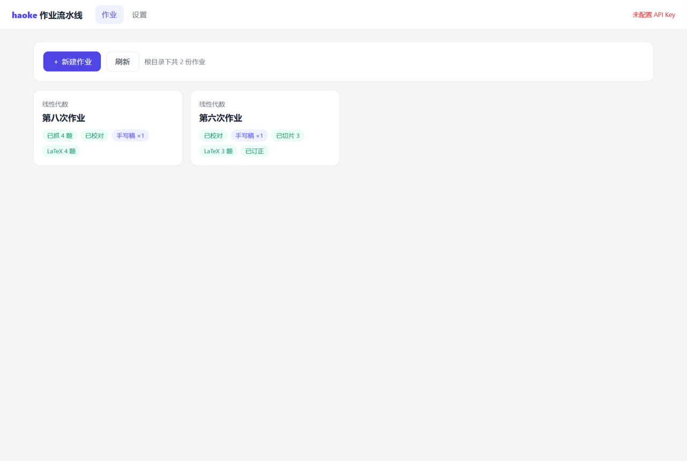
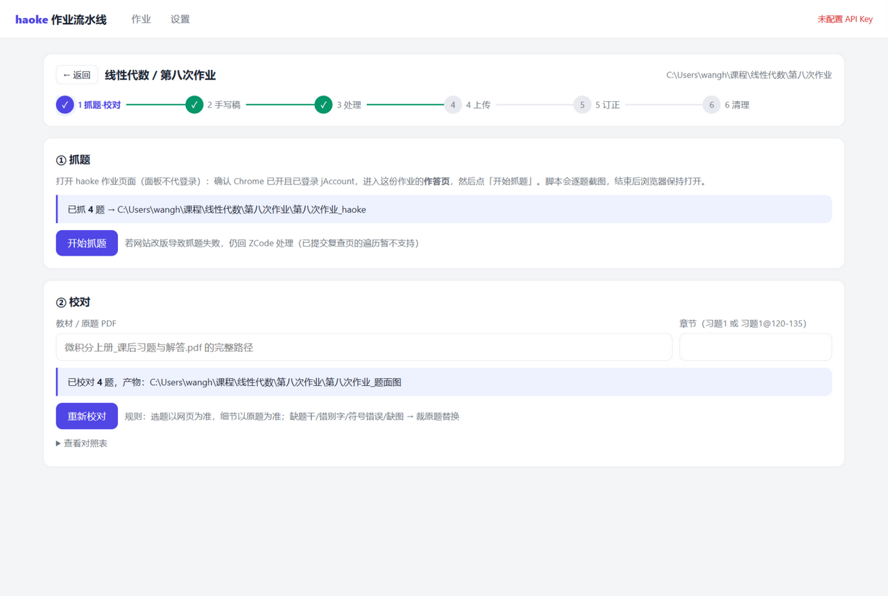
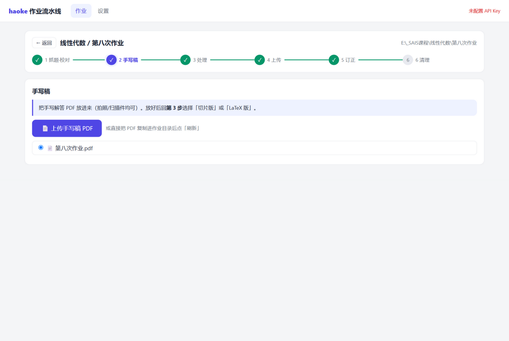
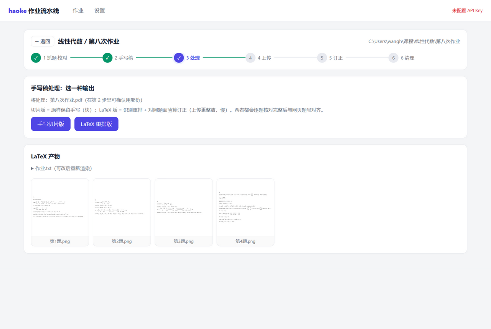
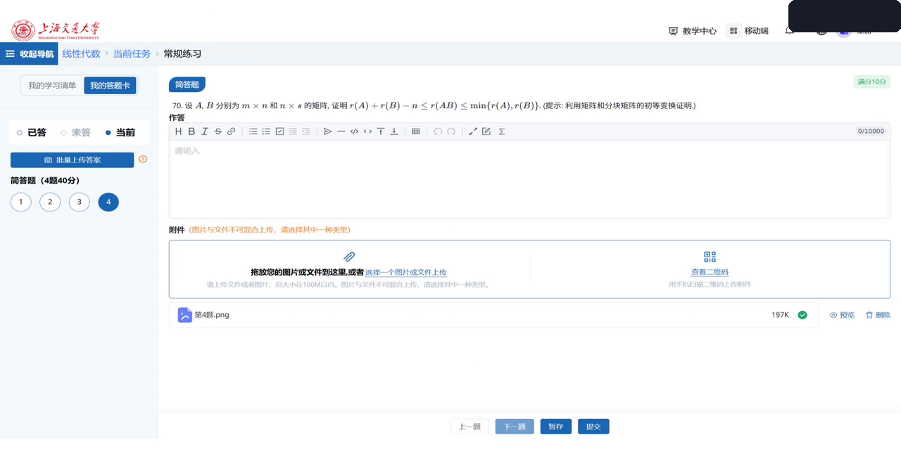
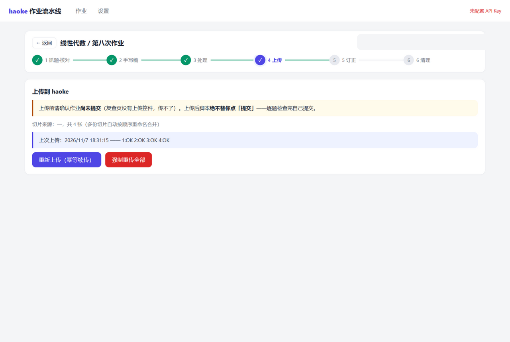
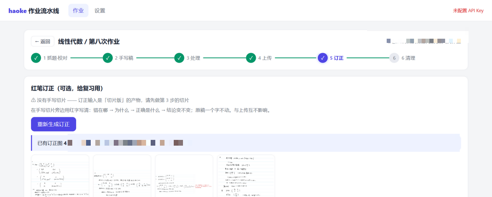
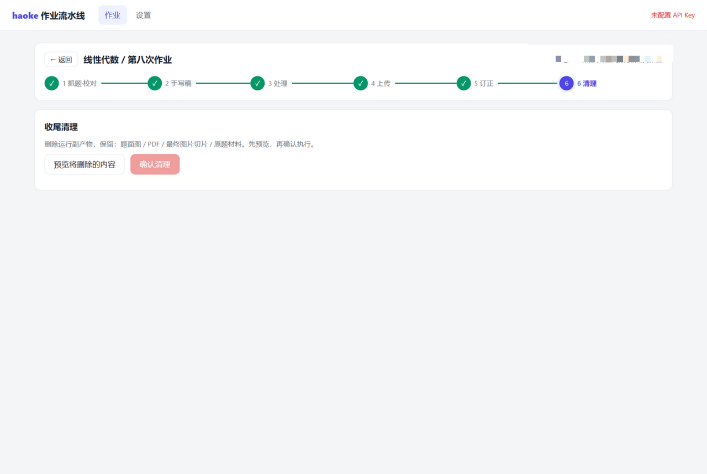
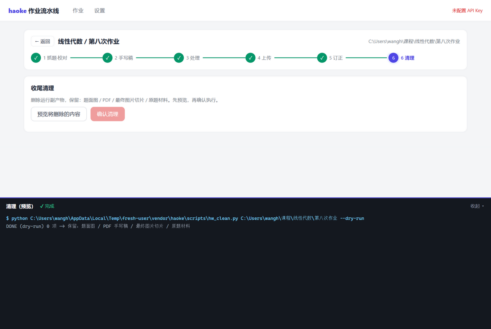

# haoke 作业流水线 · 本机面板


把 haoke（sjtu.aihaoke.net）作业全流程装进一个网页面板：**抓题 → 题面校对 → 上传手写稿 → LaTeX 重排 / 按题切片 → 自动上传 → 红笔订正 → 清理**。

- 确定性步骤（抓题、切图、渲染、上传、清理）驱动随附脚本，边界精确、幂等可重跑
- AI 步骤（题面校对、挑大题首行、LaTeX 转写与验算订正、红笔批注）由面板后端直调 **OpenAI 兼容视觉接口**，不依赖任何 Agent 会话
- 仅监听 `127.0.0.1`，API Key 与作业数据全部留在本机

## 演示

真实作业（线性代数·第八次，4 题）全流程截图：

| 登录 jAccount | 作业列表与进度 |
|---|---|
|  |  |

| ① 抓题·校对 | ② 上传手写稿 |
|---|---|
|  |  |

| ③ 处理：切片 / LaTeX 重排 | ④ 上传：平台作答页附件就位 |
|---|---|
|  |  |

| ④ 上传结果（面板） | ⑤ 红笔订正 |
|---|---|
|  |  |

| ⑥ 清理 | 清理完成 |
|---|---|
|  |  |

## 流水线

面板把一次作业组织成六步向导，每步产物落盘、可单独重跑：

1. **抓题·校对** — 复用本机 Chrome（调试端口 9222，绝不关闭窗口）逐题截图并存题面文本；随后在教材 PDF 中定位原题（书签/文字层/页码区间），逐题视觉比对，执行「选题以网页为准，细节以原题为准」：缺题干、错别字、符号错误、缺图的裁原题替换，产出 `题面图/` 与 `对照表.md`。
2. **手写稿** — 把手写解答 PDF 拖进面板（或复制进作业目录），多份 PDF 自动按顺序合并编号。
3. **处理**（二选一）
   - **手写切片版**（快）：拆行 → 视觉模型逐格挑出大题首行（下刀永远落在两题之间的空白带）→ 按题切图 → 校对总览自动复核，开头不是题号的自动并入上一张。
   - **LaTeX 重排版**（整洁）：逐页视觉转写（分页去重、页眉剔除）→ **逐题对照题面真算验算**，确认写错/写漏的按「最小改动原则」紧贴原稿修正——写对的逐字照抄，不补步骤、不加另解，正确 ≠ 完整 → MathJax 渲染每题一张 PNG → 渲染抽查。
4. **上传** — 逐题把 `第n题.png` 传进平台作答区并验证 success，幂等可续传。**绝不代点「提交」**。
5. **红笔订正**（可选）— 在手写切片旁生成红字订正（错在哪 → 为什么 → 正确是什么 → 结论变不变），红点精确指向出错行，原稿一字不动。
6. **清理** — 先预览将删除的运行副产物，确认后执行（保留题面图 / PDF / 最终切片 / 原题材料）。

## 快速开始

要求：Node 18+、Python 3.10+（`pymupdf` `pillow` `numpy` `matplotlib`）、本机 Chrome/Edge（抓题上传用，需能登录 jAccount）。

```bash
git clone https://github.com/chiyeeheh/aihaoke-webui.git
cd aihaoke-webui
npm install
npm start          # 打开 http://127.0.0.1:8420
```

首次使用先到 **设置** 页：

| 配置 | 说明 |
|---|---|
| Base URL | 默认 OpenAI `https://api.openai.com/v1`，可换任何 OpenAI 兼容服务（智谱 `https://open.bigmodel.cn/api/paas/v4`、Qwen 等） |
| API Key | 存本机 `config.json`，不会离开这台机器 |
| 视觉模型 | 校对/挑行/转写/红笔共用（如 `glm-4.5v`、`qwen-vl-max`、`gpt-4o`） |
| 作业根目录 | 按「课程/第N次作业」两层结构扫描，例如 `D:\课程` |

每份作业约 30–60 次视觉调用，费用取决于所用服务。

## 项目结构

```
webui/
├─ server.mjs        Express API + SSE 日志（只绑 127.0.0.1）
├─ lib/
│  ├─ llm.mjs        OpenAI 兼容客户端（视觉、JSON 输出、重试）
│  ├─ jobs.mjs       后台作业运行器（子进程日志流、每作业互斥）
│  ├─ paths.mjs      设置、路径白名单、作业扫描与产物探测
│  ├─ steps/         capture/upload/clean 包装 + proofread/split/latex/redpen AI 编排
│  └─ py/            教材定位 / 渲染 / 行号标注小工具
├─ vendor/           独立分发用的流水线脚本副本（见 vendor/README.md）
├─ public/           无构建原生 JS 前端
├─ assets/           演示素材
├─ config.json       设置（运行时生成，gitignore）
└─ data/             每作业运行状态与中间产物（gitignore）
```

脚本来源：若本机装有对应的 skill（`sjtu-aihaoke-automation` 等，与本仓库同级），面板优先使用 skill 原版脚本；否则回退到 `vendor/` 副本，首次运行自动安装 Node 依赖。

## 隐私与铁律

- **绝不关闭 Chrome**：抓题/上传结束只断开 puppeteer 连接，登录态留给下次
- **绝不代点「提交」**：上传完成后由用户人工检查提交
- 已提交复查页的抓题（答题卡遍历）暂不支持；网站改版导致选择器失效时需更新 `--stem-selector`
- 面板不采集任何数据；API Key 与作业数据不出本机

## License

[MIT](LICENSE)
